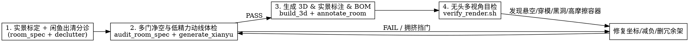

# Room Storage Designer (`v2.1` 低精力防反扑 + 闲鱼回血版)

## Overview

**物理真实感优先于幻想装饰，低精力 1 秒归位优先于强迫症美图，先闲鱼出清再买收纳。**  
本技能结合建筑尺度规范（GB 50096）、**1 秒免拆盖免叠放防反扑人机学**、**闲鱼闲置变现抵扣管线**、防宠防破坏选品与可交互 3D WebGL 仿真。支持将实拍照片或手绘俯视图直接标定为防撞 3D 空间与可执行 BOM/出清台账。

---

## Core Discipline: Zero Hardcoding & Low-Friction Reality

**违背字面规则即违背原则。无一例外：**
1. **零硬装篡改默认红线**：门洞、门开合朝向、窗户位置、原墙色、地砖与固定电器位置 100% 锁死；除用户主动授权，全套免打孔免伤墙。
2. **低精力防反扑铁律 (`<= 1 步归位`)**：**严禁把每日高频物件（每天穿脱的球鞋、运动汗衣、睡前随手杂物、球包）塞进要蹲下掰盖的密闭箱！** 日常高频全部用**无盖随手筐 + 敞开斜插架 + 高位粗挂钩**，密闭箱只留给换季备品。
3. **先出清、再规划 (`Xianyu Triage First`)**：看到破损电子件、吃灰小家电或多余杂物，必须先生成**闲鱼挂单文案与自提清场建议**并核算净花费，禁止花钱买架子囤废品。
4. **先体检，后出图；眼见为实门禁**：未过 `audit_room_spec.py` 或同等级空间多门碰撞校验、未经 `verify_render.sh` 无头截图亲眼目检前，禁止宣告完成。

---

## Workflow (4-Step Deterministic Pipeline)



### Step 1: 照片标定、6 项清点与「闲鱼闲置扫描」
- 阅读 [photo-calibration-guide.md](references/photo-calibration-guide.md)，以门高 (`2.05m`)、砖网格与用户补充俯视方位（特别核对**阳台是否窄条/封窗、卧室睡眠门朝向**）标定几何坐标。
- 阅读 [spatial-and-pet-rules.md](references/spatial-and-pet-rules.md)（重点执行**第 5 节：低精力 ≤ 1秒防反扑铁律**与**保洁挂墙/带轮规则**）。
- 阅读 [xianyu-declutter-guide.md](references/xianyu-declutter-guide.md)：扫描图内坏屏/冗余家电/大件垃圾，输出 🟢闲鱼变现 / 🟡¥0.01自提 / 🔴直接扔 三分诊列表。

### Step 2: 数学体检与闲鱼账本生成 (`MANDATORY`)
```bash
python3 scripts/audit_room_spec.py <your_room_spec.json>
python3 scripts/generate_xianyu_cards.py <your_declutter.json> --bom-total 169
```
务必核对：**多门交通枢纽全清（绝不在卧室门/阳台门/厨房门前硬塞储物台或猫砂）、主干通道净宽达标、球拍挂钩 `>= 1.70m` 防猫**。

### Step 3: 注入引擎与生成实景对比看板
- 卧室单间户型可直接跑 `python3 scripts/build_3d_from_spec.py <room_spec.json> <out_dir>`；异形过道/多门走廊户型按实景构造 1:1 WebGL 视图（须严格遵守 [threejs-anti-bug-cookbook.md](references/threejs-anti-bug-cookbook.md)）。
- 用 `python3 scripts/annotate_room.py` 出原图施工蓝图（限位防裁切）；配合 [before_after_slider.html](templates/before_after_slider.html) 呈现**Before/After 拖动对比 + 采购 BOM + 闲鱼文案一键复制与净花费计算**。

### Step 4: 多视角目检门禁 (`MANDATORY`)
- 跑 `bash scripts/verify_render.sh` 截取全屋俯瞰、实拍同机位、局部特写，并借助 `read_file` 亲自确认：**零 Z-fighting 地面撕裂、零黑洞门外虚空、零悬空/穿模物体、无过重阻挡采光的大高架**。

---

## Semantic Design Versioning (4 套预设风格与低精力策略)

| 版本代号 | 定位与壁面工法 | 核心配置策略（硬装零改动） | 参考预算 |
| :--- | :--- | :--- | :--- |
| **`v1.0-Lazy`** | **打工人防反扑默认 · ≤1秒顺手归位** | 机侧磁吸架 + 敞开斜插窄鞋架 + 无盖大口随手筐 + 高位球包钩 + 拖把悬空挂卡 | ¥150 ~ ¥220 (出闲置常净赚) |
| **`v2.2-MUJI`** | 治愈原木亚麻风（适合带独立衣柜卧室） | 暖橡木碳钢衣柜(含防尘帘) + MUJI 抽屉 + 剑麻猫爬柱 | ¥850 ~ ¥950 |
| **`v2.0-Tech`** | 黑金机能极客（可选免钉/洞洞板） | 哑光黑钢架 + 熏黑密封桶 + 碳素护墙板 + 暖夜灯 | ¥1,050 ~ ¥1,200 |
| **`v2.1-Camping`** | 都市露营风（高频搬家直装） | 军绿钢管架 + 侧开折叠箱群 + 剑麻耐磨毯 | ¥900 ~ ¥1,050 |

---

## Red Flags & Rationalization Table (STOP 判断清单)

| 偷懒 / 本末倒置念头 | 真实后果与强制纠偏 |
| :--- | :--- |
| "给下班累瘫的用户选一堆前开带盖透明塑料盒配精装叠衣" | **拦截**：三天必反弹！每日高频鞋服/杂物必须改敞开斜插鞋架+无盖随手筐+墙面粗挂钩（步数 `<= 1`）。 |
| "照片里有一台坏显示器/俩旧风扇，帮他在柜子上留个位子摆着" | **拦截**：给垃圾买柜子最亏！必须先进 `generate_xianyu_cards.py` 出闲鱼自提文案变现清场。 |
| "在5门交通枢纽洗衣机上硬架1.88m黑铁三层架显得收纳能力强" | **拦截**：堵死阳台采光与人行压迫感！洗衣机旁有门时宁可用机侧磁吸+门背钩减法留空。 |
| "猫砂盆图方便随便放门边，没标出卧室门在哪" | **拦截**：必须追问或显式标出睡眠卧室门与阳台窄宽/封窗情况，死守门前 `1m+` 净空。 |
