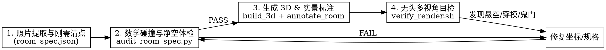

# Room Storage Designer (`v2.0` 数据驱动版)

## Overview

**物理真实感优先于幻想装饰，数据与引擎彻底解耦。**  
本技能将建筑尺度规范（GB 50096）、防宠防破坏选品学、实景照片像素标定，以及可交互 3D WebGL 仿真工作台结合。接到房间照片后，只生成**声明式 `room_spec.json`** 并通过数学脚本过检，再自动生成支持激光测距、第一人称/猫视角漫游、拖拽碰撞预警、2D 实时户型图与 AR QuickLook 导出的 1:1 方案。

---

## Core Discipline: Zero Hardcoding & Anti-Hallucination

**违背字面规则即违背原则。无一例外：**
1. **零硬装篡改默认红线**：门洞、门开合朝向、窗户位置、原墙色、地砖与固定床架 100% 绝对锁死。除非用户主动授权“可打孔”，所有版本默认零墙面永久损伤。
2. **先体检，后出图**：未通过 `scripts/audit_room_spec.py` 碰撞/动线校核前，禁止生成最终 HTML 或向用户宣告完成。
3. **眼见为实门禁**：3D 模型改动后必须通过 `scripts/verify_render.sh` 抓取全角度无头浏览器截图并使用图片读取亲自目检（确认无悬空、无穿模、无黑洞鬼门），再展示给用户。

---

## Workflow (4-Step Deterministic Pipeline)



### Step 1: 照片标定与高频杂物清点
- 阅读 [photo-calibration-guide.md](references/photo-calibration-guide.md)，以门高 (`2.05m`) 和地砖模数 (`600/800mm`) 提取房间长宽及家具坐标，写为 `room_spec.json`。
- 阅读 [spatial-and-pet-rules.md](references/spatial-and-pet-rules.md)，**逐一核对 6 大易漏杂物**：① 换季长短挂衣与叠衣抽屉；② 20~28 寸大行李箱顶层高位泊位；③ 透明防尘鞋盒；④ 羽拍等长杆器材高位壁挂；⑤ 桌面立式书立与零食架；⑥ 养猫防抓防毛（防尘帘+密封桶+剑麻抓柱）。

### Step 2: 运行静态数学体检 (`MANDATORY`)
```bash
python3 scripts/audit_room_spec.py <your_room_spec.json>
```
确保通过：**墙内边界零出界、门扇开合扇区全清、`>= 85cm` 主干通道、床下箱高 `< 净高 - 2cm`、抽屉拉出路径与猫食盆/桌椅零干涉**。

### Step 3: 注入引擎并生成实景批注图
- 用 `python3 scripts/build_3d_from_spec.py <room_spec.json> <out_dir>` 生成完整 1:1 交互 HTML（自动打包 `templates/libs/` 与 6 大 Pro 控件：激光测距、摆位拖拽红线、真人/猫视角漫游、2D 实时户型图、ViewCube 魔方、昼夜切换与 BOM 换装清单）。
- 用 `python3 scripts/annotate_room.py <photo.jpg> <ann.json> <blueprint.jpg>` 生成防越界、带智能引线的实景施工蓝图。
- 若有改造前后图，注入 [before_after_slider.html](templates/before_after_slider.html) 生成对比看板。

### Step 4: 多视角目检门禁 (`MANDATORY`)
- 扩展自定义 3D 构件时必读 [threejs-anti-bug-cookbook.md](references/threejs-anti-bug-cookbook.md)。
- 启动本地静态 HTTP 服务，执行 `bash scripts/verify_render.sh <url> <out_dir>` 截取全景、衣柜正视、书桌、床底抽出态、猫咪区 5 张截图并用图片查看工具逐一核验。

---

## Semantic Design Versioning (4 套预设风格与 BOM)

| 版本代号 | 定位与壁面工法 | 核心配置与材质切换（硬装零改动） | 参考预算 |
| :--- | :--- | :--- | :--- |
| **`v1.0-Basic`** | 极限性价比 · 100% 免打孔 | 轻量碳钢挂衣架 + 涤棉帘 + 门背无痕钩 + PP抽屉 | ¥400 ~ ¥500 |
| **`v2.2-MUJI`** | 默认推荐 · 治愈原木亚麻风 | 暖橡木碳钢衣柜(含防尘帘) + MUJI 6格磨砂抽屉 + 棉麻脏衣篮 | ¥850 ~ ¥950 |
| **`v2.0-Tech`** | 黑金机能极客（可选免钉/洞洞板） | 哑光黑钢架 + 熏黑抽屉 + 金扣密封桶 + 深灰短绒地毯 + 暖夜灯 | ¥1,050 ~ ¥1,200 |
| **`v2.1-Camping`** | 都市露营风（高频搬家直装） | 军绿钢管架 + 侧开折叠箱群 + 剑麻耐磨毯 + 伞绳挂袋 | ¥900 ~ ¥1,050 |

---

## Red Flags & Rationalization Table (STOP 判断清单)

| 偷懒念头 / 典型借口 | 真实后果与强制纠偏 |
| :--- | :--- |
| "照片只拍到乱零食和球拍，先不管衣柜行李箱" | **拦截**：租房衣柜+28寸箱占位最大，必须主动询问或在 `room_spec` 中预设专属库位。 |
| "盒子叠在一起坐标大概对就行了" | **拦截**：产生桌面悬空书、猫咪钻抽屉穿模。桌上物品必须挂父组局部坐标，且过 `audit_room_spec.py`。 |
| "实心盒子直接画个门套最省事" | **拦截**：门一开变成双门鬼影。必须使用镂空门挺拼接+外走廊照明。 |
| "看场景不黑就能用，不用切进衣柜特写截图了" | **拦截**：极易遗漏背面 X 撑穿出、遮挡黑洞背景或实心水碗看不见粮水。必须全角度截图目检。 |
